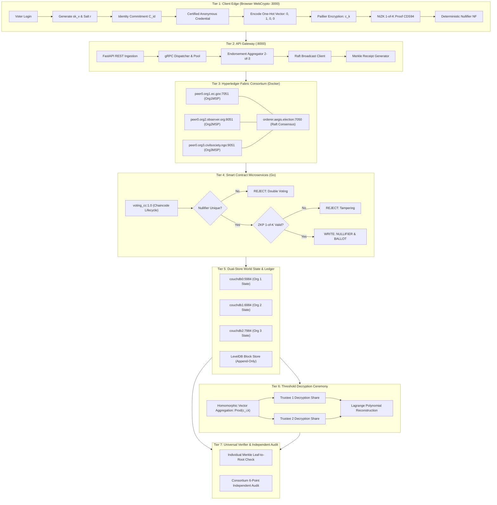

# AegisVote: Complete End-to-End Operational & Deployment Guide

> **Official Implementation Manual for the 3-Organization Hyperledger Fabric Consortium E-Voting Network**  
> *PESCE Mandya | Final Year Engineering Project (2026–27)*

---

## 🏛️ Comprehensive Multi-Tier Architecture



*(For the complete mathematical formulations and data schemas, see the primary [README.md](file:///Users/poorna-yashas/Documents/voting-blockchain/README.md).)*

---

## 📋 Prerequisites & Environment Setup

Ensure the following tools are installed on your Mac or Linux workstation:
- **Docker Desktop** (Engine 20.10+ / 24+ / 29+)
- **Go** (v1.20+)
- **Node.js** (v18+)
- **Python** (v3.9+)

---

## 🚀 Complete Commands: From Start to Finish

### 1. Blockchain Network Deployment (Docker)

#### 1.1 Generate Cryptographic Certificates & Channel Genesis (Only needed once or on clean reset)
```bash
./blockchain/network/scripts/generate_artifacts.sh
```
*Generates MSP certificates for OrdererOrg, Org1MSP, Org2MSP, Org3MSP and builds `genesis.block` and `votingchannel.tx`.*

#### 1.2 Start Consortium Docker Containers
```bash
cd blockchain/network
docker compose -f docker-compose-consortium.yaml up -d
cd ../..
```
*Spins up 1 Raft Orderer, 3 Org Peers, 3 CouchDB instances, and 1 Admin CLI container.*

#### 1.3 Verify All Containers are Running
```bash
docker ps --format "table {{.Names}}\t{{.Status}}\t{{.Ports}}"
```
*You should see 8 running containers (`orderer`, `peer0.org1`, `peer0.org2`, `peer0.org3`, `couchdb0`, `couchdb1`, `couchdb2`, `aegis_cli`).*

#### 1.4 Create & Join Consortium Channel (`votingchannel`)
```bash
docker exec aegis_cli /bin/bash /opt/gopath/src/github.com/hyperledger/fabric/peer/scripts/create_and_join_channel.sh
```
*Creates `votingchannel` on Raft orderer and joins all 3 organization peers.*

#### 1.5 Deploy & Commit Smart Contract (`voting_cc`)
```bash
docker exec aegis_cli /bin/bash /opt/gopath/src/github.com/hyperledger/fabric/peer/scripts/deploy_chaincode.sh
```
*Packages Go chaincode, installs it on all 3 peers, collects 2-of-3 endorsement approval, commits definition on channel, and initializes the election on ledger.*

---

### 2. Application Tier Execution (Backend & Frontend)

#### Option A: One-Click Launch (Recommended for macOS)
```bash
./start_mac.sh
```
*Automatically sets up Python virtualenv, installs frontend packages, boots FastAPI on `http://127.0.0.1:8000`, launches Vite on `http://localhost:3000`, and opens your default browser.*

#### Option B: Manual Multi-Terminal Launch

**Terminal 1 — FastAPI Backend:**
```bash
cd backend
python3 -m venv venv
source venv/bin/activate
pip install -r requirements.txt
python3 main.py
```
- API Server: `http://127.0.0.1:8000`
- Interactive Swagger API Docs: `http://127.0.0.1:8000/docs`

**Terminal 2 — React Frontend:**
```bash
cd frontend
npm install
npm run dev
```
- Web Application: `http://localhost:3000`

---

## 🗳️ Step-by-Step Web Application Walkthrough

### Stage 1: Voter Login & Credential Issuance
1. Open **`http://localhost:3000`** in your browser.
2. Click **"Voter Portal"** / **"Sign In"**.
3. Use any of the pre-seeded electoral test accounts:
   - **Voter ID**: `VOTER-001` | **Password**: `password123` *(Poorna Chandra)*
   - **Voter ID**: `VOTER-002` | **Password**: `password123` *(Vikas B)*
   - **Voter ID**: `VOTER-003` | **Password**: `password123` *(Darshan C)*
   - **Voter ID**: `VOTER-004` | **Password**: `password123` *(Karthik S)*
4. The system validates identity under NIST SP 800-63-3, and your browser derives a private secret $sk_v$ and obtains an anonymous credential bound to the election.

### Stage 2: Cast Encrypted Ballot
1. Choose a candidate from the ballot list.
2. Click **"Seal & Cast Encrypted Ballot"**.
3. **What happens client-side**:
   - One-hot vector $[0, 1, 0, 0]$ is encrypted using Paillier public key $(n, g)$.
   - NIZK 1-of-K selection proof is generated.
   - Deterministic nullifier $NF = \text{HMAC-SHA256}(sk_v, \text{"NULLIFIER:election-pesce-2026"})$ is derived.
4. **On-Chain Blockchain Commit**:
   - The proposal is dispatched to `peer0.org1` and `peer0.org2`.
   - The chaincode validates nullifier uniqueness and stores the ballot in the world state.
   - You receive an immutable **Ballot Inclusion Receipt** with the transaction ID and Merkle leaf hash.

### Stage 3: Test Sybil / Double Voting Defense
1. Without logging out, or after signing in again with `VOTER-001`, attempt to vote for another candidate.
2. **Result**: The transaction fails with:
   ```
   DOUBLE_VOTING_ERROR: Nullifier has already been recorded on the ledger
   ```
   *Demonstrates complete mathematical immunity to duplicate voting.*

### Stage 4: Threshold Homomorphic Tallying
1. Navigate to the **"Consortium Console"** (`/consortium`).
2. Click **"Close Voting & Begin Tally Ceremony"**.
3. The system homomorphically multiplies all ciphertexts from the ledger:
   $$C_{\text{aggregate}}[k] = \prod_{i=1}^N c_{i, k} \pmod{n^2}$$
4. Trustees 1 and 2 submit partial decryption shares. Lagrange interpolation recovers the final plaintext candidate totals without ever exposing individual votes.

### Stage 5: Independent 3-Authority Audit
1. Navigate to the **"Universal Verifier"** (`/verifier`).
2. Enter your Transaction ID from the receipt to check your Merkle inclusion path.
3. Review the 6 independent checks conducted by Org 1, Org 2, and Org 3:
   - Ballot Validity
   - Nullifier Uniqueness
   - Accepted Ballot Count
   - Blockchain Integrity
   - Homomorphic Sum Correctness
   - Tally Consistency

---

## 🔍 Blockchain Inspection & CLI Commands

Run these commands in any terminal:

### 1. Query Election Metadata from Fabric Ledger
```bash
docker exec aegis_cli peer chaincode query \
  -C votingchannel \
  -n voting_cc \
  -c '{"function":"QueryElection","Args":["election-pesce-2026"]}'
```

### 2. View Live Peer Block & Endorsement Logs
```bash
docker logs peer0.org1.ec.gov --tail 25
```

### 3. Inspect CouchDB World State Database in Browser
- URL: **`http://localhost:5984/_utils`**
- Username: `admin` | Password: `adminpw`
- Open database: **`votingchannel_voting_cc`** to inspect the live JSON documents for ballots, election parameters, and nullifiers.

### 4. Run the Full Automated Test Suite (13 Tests)
```bash
backend/venv/bin/pytest backend/tests/ -v
```

---

## 🧹 Network Teardown & Clean Reset

- **To pause the containers**:
  ```bash
  cd blockchain/network && docker compose -f docker-compose-consortium.yaml stop
  ```
- **To resume paused containers**:
  ```bash
  cd blockchain/network && docker compose -f docker-compose-consortium.yaml start
  ```
- **To completely reset and wipe the network**:
  ```bash
  ./blockchain/network/scripts/generate_artifacts.sh
  cd blockchain/network
  docker compose -f docker-compose-consortium.yaml down -v
  docker compose -f docker-compose-consortium.yaml up -d
  sleep 3
  docker exec aegis_cli /bin/bash /opt/gopath/src/github.com/hyperledger/fabric/peer/scripts/create_and_join_channel.sh
  docker exec aegis_cli /bin/bash /opt/gopath/src/github.com/hyperledger/fabric/peer/scripts/deploy_chaincode.sh
  ```

