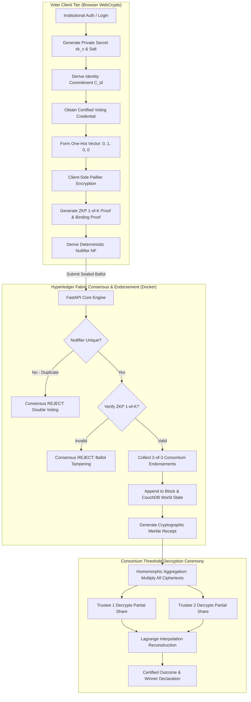

# AegisVote: Enterprise Privacy-Preserving Blockchain E-Voting Infrastructure

> **Institutional-Grade, Zero-Knowledge, Homomorphic E-Voting Architecture on Hyperledger Fabric with Multi-Organization Consensus & CouchDB World State.**  
> Built for the Final Year Engineering Project (2026–27) | Department of Information Science & Engineering, P.E.S. College of Engineering, Mandya.

---

## 👥 Academic & Engineering Credits

- **Institution**: P.E.S. College of Engineering (PESCE), Mandya – 571401  
- **Department**: Department of Information Science & Engineering  
- **Faculty Project Guide**: **Dr. Rakshith N**, Associate Professor, Dept. of IS&E, PESCE Mandya  
- **Student Development Team**:
  1. **Poorna Chandra DH** (USN: `4PS23IS039`) — *Lead Cryptographic Architect & Core Backend*
  2. **Vikas B** (USN: `4PS23IS064`) — *Smart Contracts & Hyperledger Consensus Lead*
  3. **Darshan C** (USN: `4PS23IS007`) — *Cloud Infrastructure & Persistence Lead*
  4. **Karthik S** (USN: `4PS23IS027`) — *Enterprise Frontend & UI/UX Systems*

---

## 🏛️ Executive Summary & The E-Voting Trilemma

Remote electronic elections have historically suffered from the **E-Voting Trilemma**:
1. **Unconditional Ballot Secrecy**: No party (not even the election commission, government, or system administrator) can tie a cast ballot back to a voter's real-world identity.
2. **Individual Verifiability**: A voter can mathematically verify that their ballot was cast as intended and immutably recorded on the ledger (*"Cast as intended, recorded as cast"*).
3. **Universal Verifiability**: Any third-party auditor, journalist, or public observer can verify that the final tally equals the exact sum of all valid ballots without decrypting any individual ballot (*"Tallied as recorded"*).

### How AegisVote Solves the Trilemma:
- **Zero Exposure via Paillier Homomorphism**: Ballots are encrypted client-side using Paillier additive homomorphic encryption. The tally is computed homomorphically by multiplying ciphertexts together—individual votes are **never decrypted**.
- **No Single Point of Failure (SPoF)**: Employs a **2-of-3 Threshold Decryption Ceremony** split across 3 sovereign consortium trustees:
  - **Trustee 1**: Election Commission of India / PESCE EC (`Org1MSP`)
  - **Trustee 2**: Independent Electoral Oversight / Cyber Cell (`Org2MSP`)
  - **Trustee 3**: Public Civil Watchdog NGO (`Org3MSP`)
- **Sybil & Double-Voting Immunity**: Enforces **Credential-Bound Deterministic Nullifiers** ($NF = \text{HMAC-SHA256}(sk_v, \text{"NULLIFIER:"} \mathbin{\Vert} \text{election\_id})$) with zero-knowledge binding proofs.
- **Client-Side Proofs**: Non-Interactive Zero-Knowledge (NIZK) proofs demonstrate ballots satisfy 1-of-K selection constraints without revealing the chosen candidate.
- **Live Multi-Org Hyperledger Fabric Consortium**: A 3-organization Dockerized Fabric network with Raft ordering, per-peer CouchDB world state databases, and 2-of-3 endorsement policies.

---

## 🏗️ System Architecture & Workflow



---

## 🔬 Mathematical & Algorithmic Foundations

### 1. Paillier Additive Homomorphic Encryption
Let $n = p \cdot q$ be the RSA modulus, $\lambda = \text{lcm}(p-1, q-1)$, and $g = n + 1$.
- **Encryption**: For message $m \in \{0, 1\}$ and blinding factor $r \in \mathbb{Z}_n^*$:
  $$c = \mathcal{E}(m) = g^m \cdot r^n \pmod{n^2}$$
- **Homomorphic Multiplication Property**:
  $$\mathcal{E}(m_1) \cdot \mathcal{E}(m_2) = (g^{m_1} r_1^n)(g^{m_2} r_2^n) = g^{m_1 + m_2} (r_1 r_2)^n \equiv \mathcal{E}(m_1 + m_2) \pmod{n^2}$$
- **Aggregate Vector Tally**: For $N$ accepted ballots across $K$ candidates:
  $$C_{\text{aggregate}}[k] = \prod_{i=1}^N c_{i, k} \pmod{n^2} = \mathcal{E}\left(\sum_{i=1}^N v_{i, k}\right)$$
  *Decrypting $C_{\text{aggregate}}$ directly yields the final tally without exposing single votes!*

### 2. Credential-Bound Deterministic Nullifier
- To prevent double voting without deanonymizing voters, each voter derives:
  $$\text{NF} = \text{HMAC-SHA256}(sk_v, \text{"NULLIFIER:"} \mathbin{\Vert} \text{election\_id})$$
- Because $sk_v$ is fixed per voter and certified by the credential, exactly one valid nullifier exists per voter per election.
- The smart contract records `NULLIFIER_<election_id>_<NF>` as `SPENT` in the same atomic transaction as the ballot. Any duplicate submission triggers an immediate transaction rejection.

### 3. Hyperledger Fabric Dual-Store Architecture
- **Transaction Lifecycle**: Execute proposal simulation on endorsing peers (`peer0.org1`, `peer0.org2`, `peer0.org3`) $\to$ Verify 2-of-3 endorsement signatures $\to$ Raft Orderer batches into immutable blocks $\to$ Commit to per-peer CouchDB world state.
- **Endorsement Policy**:
  $$\text{Policy} = \text{OutOf}(2, \text{'Org1MSP.member'}, \text{'Org2MSP.member'}, \text{'Org3MSP.member'})$$

---

## 📦 Container Topology & Active Network Nodes

| Container Name | Role | Port | State Store |
| :--- | :--- | :--- | :--- |
| **`orderer.aegis.election`** | **Raft Consensus Orderer** (`OrdererMSP`) | `7050` | Blocks sequenced with Raft finality |
| **`peer0.org1.ec.gov`** | **Org 1: Election Commission Peer** (`Org1MSP`) | `7051` | Endorsing peer |
| **`couchdb0`** | **Org 1 World State Store** | `5984` | Stores `votingchannel_voting_cc` |
| **`peer0.org2.observer.org`** | **Org 2: Party Observer Peer** (`Org2MSP`) | `8051` | Endorsing peer |
| **`couchdb1`** | **Org 2 World State Store** | `6984` | Independent replicate state |
| **`peer0.org3.civilsociety.ngo`**| **Org 3: Civil Society NGO Peer** (`Org3MSP`) | `9051` | Endorsing peer |
| **`couchdb2`** | **Org 3 World State Store** | `7984` | Independent replicate state |
| **`aegis_cli`** | **Consortium CLI & Gateway Client** | N/A | Admin & Chaincode lifecycle |
| **`dev-peer0.*-voting_cc_1.0`** | **Active Smart Contract Microservices** | Internal | Go chaincode runtime containers |

---

## ⚡ Complete Deployment & Execution Guide (Scratch to End)

### Prerequisites Installation (macOS / Linux)
```bash
# 1. Install Docker Desktop, Go, and Node.js (via Homebrew on macOS)
brew install --cask docker
brew install go node python

# 2. Start Docker Desktop and verify:
docker --version && go version && node --version
```

---

### Phase 1: Bootstrap the Hyperledger Fabric Network

#### 1. Generate Certificates & Channel Genesis Artifacts
```bash
./blockchain/network/scripts/generate_artifacts.sh
```
*Generates cryptographic material (`crypto-config`) for all 3 organizations and Raft Orderer, and builds `genesis.block` and `votingchannel.tx`.*

#### 2. Launch the 8 Consortium Docker Containers
```bash
cd blockchain/network
docker compose -f docker-compose-consortium.yaml up -d
cd ../..
```

#### 3. Verify All Nodes are Active
```bash
docker ps --format "table {{.Names}}\t{{.Status}}\t{{.Ports}}"
```

#### 4. Create Channel & Join All 3 Peers
```bash
docker exec aegis_cli /bin/bash /opt/gopath/src/github.com/hyperledger/fabric/peer/scripts/create_and_join_channel.sh
```

#### 5. Package, Install, Approve & Commit Smart Contract (`voting_cc`)
```bash
docker exec aegis_cli /bin/bash /opt/gopath/src/github.com/hyperledger/fabric/peer/scripts/deploy_chaincode.sh
```
*Packages `voting_contract.go`, installs across all 3 peers, approves the 2-of-3 endorsement definition, commits it on `votingchannel`, and initializes the election on the ledger.*

---

### Phase 2: Start the Application Tier

#### One-Click Launch (macOS):
```bash
chmod +x start_mac.sh
./start_mac.sh
```
*Automatically sets up Python virtualenv, installs frontend packages, boots FastAPI on `http://127.0.0.1:8000`, launches Vite on `http://localhost:3000`, and opens your default browser.*

#### Manual Launch (Separate Terminals):
- **Terminal 1 — FastAPI Backend:**
  ```bash
  cd backend
  python3 -m venv venv
  source venv/bin/activate
  pip install -r requirements.txt
  python3 main.py
  ```
  - API Server: `http://127.0.0.1:8000`
  - Interactive Swagger API Documentation: `http://127.0.0.1:8000/docs`

- **Terminal 2 — React / Vite Frontend:**
  ```bash
  cd frontend
  npm install
  npm run dev
  ```
  - Web Application: `http://localhost:3000`

---

## 🗳️ Web Application User Journey (10 Stages)

### 1. Voter Authentication & Credential Issuance
1. Navigate to **`http://localhost:3000`** $\to$ Click **"Voter Portal"**.
2. Sign in using any pre-seeded synthetic test account:
   - `VOTER-001` / `password123` *(Poorna Chandra)*
   - `VOTER-002` / `password123` *(Vikas B)*
   - `VOTER-003` / `password123` *(Darshan C)*
   - `VOTER-004` / `password123` *(Karthik S)*
3. Identity is verified under NIST SP 800-63-3. The browser generates secret $sk_v$ and receives an anonymous voting credential.

### 2. Client-Side Encryption & Casting
1. Select a candidate.
2. Click **"Seal & Cast Encrypted Ballot"**.
3. Browser performs Paillier encryption, generates ZKP 1-of-K validity proof, computes nullifier $NF$, and submits the proposal.
4. Peers endorse, Raft sequences the transaction into a block, and you receive an immutable **Ballot Inclusion Receipt** with the Merkle proof.

### 3. Sybil / Double Voting Defense Demonstration
1. Attempt to cast a second ballot with `VOTER-001`.
2. The transaction is instantly rejected by the smart contract on the blockchain:
   ```
   DOUBLE_VOTING_ERROR: Nullifier has already been recorded on the ledger
   ```

### 4. Consortium Tally Ceremony
1. Go to **"Consortium Console"** (`/consortium`).
2. Click **"Close Voting & Begin Tally Ceremony"**.
3. Ballots are aggregated homomorphically. Trustees 1 and 2 contribute partial decryption shares, and Lagrange reconstruction computes the final totals without decrypting single ballots.

### 5. Universal Verifier & Independent 3-Authority Audit
1. Go to **"Universal Verifier"** (`/verifier`).
2. Enter your receipt Transaction ID to verify your ballot's presence in the Merkle root.
3. Review the 6 independent checks conducted and signed by Org 1, Org 2, and Org 3:
   - Ballot Validity
   - Nullifier Uniqueness
   - Accepted Ballot Count
   - Blockchain Integrity
   - Homomorphic Sum Correctness
   - Tally Consistency

---

## 🔍 Diagnostic & Inspection Commands

Run these from any terminal window on your machine:

- **Query Live Election from Blockchain Ledger**:
  ```bash
  docker exec aegis_cli peer chaincode query -C votingchannel -n voting_cc -c '{"function":"QueryElection","Args":["election-pesce-2026"]}'
  ```

- **Inspect CouchDB World State Database in Browser**:
  Open [http://localhost:5984/_utils](http://localhost:5984/_utils) (User: `admin`, Password: `adminpw`) $\to$ Database: `votingchannel_voting_cc`.

- **Stream Live Peer Logs**:
  ```bash
  docker logs peer0.org1.ec.gov --tail 25
  ```

- **Run Automated Test Suite (13/13 passing tests)**:
  ```bash
  backend/venv/bin/pytest backend/tests/ -v
  ```

---

## 📁 Repository Directory Structure

```
voting-blockchain/
├── backend/
│   ├── app/
│   │   ├── api/routes/          # REST endpoints (auth, ballot, consortium, audit)
│   │   ├── core/                # JWT security, config, and settings
│   │   ├── crypto/              # Paillier, ZKP, and Nullifier algorithms
│   │   ├── models/              # Pydantic data schemas
│   │   └── services/
│   │       ├── fabric_service.py # Live gRPC/CLI gateway to Hyperledger Fabric
│   │       └── voting_service.py # Election lifecycle orchestration
│   ├── tests/                   # 13 automated unit & live integration tests
│   ├── main.py                  # FastAPI application entrypoint
│   └── requirements.txt         # Python dependencies
├── blockchain/
│   ├── chaincode/voting/
│   │   ├── go.mod               # Go module definition
│   │   └── voting_contract.go   # Smart contract (Fabric contract API)
│   └── network/
│       ├── configtx.yaml        # Channel profiles & Consortium definition
│       ├── crypto-config.yaml   # MSP cryptographic topology (3 Orgs + Orderer)
│       ├── docker-compose-consortium.yaml # Docker stack (8 nodes)
│       └── scripts/
│           ├── generate_artifacts.sh      # cryptogen & configtxgen runner
│           ├── create_and_join_channel.sh # Channel genesis and peer joins
│           └── deploy_chaincode.sh        # Chaincode lifecycle deployment
├── frontend/
│   ├── src/
│   │   ├── components/          # Reusable UI cards, tables, modals
│   │   ├── pages/               # Voter Portal, Consortium, Verifier, Chaos Sim
│   │   └── services/            # Client-side Paillier & WebCrypto crypto engine
│   ├── package.json
│   └── vite.config.ts
├── OPERATIONAL_GUIDE.md         # Exhaustive 10-stage handbook with CLI commands
├── start_mac.sh                 # One-click launcher script for macOS
└── README.md                    # Primary institutional and technical documentation
```

---

## 🛡️ Security & Threat Resistance Matrix

| Threat Vector | Attack Scenario | AegisVote Defense Mechanism |
| :--- | :--- | :--- |
| **Double Voting** | Voter submits multiple ballots with different candidates. | Deterministic nullifier $NF$ is identical; chaincode rejects duplicate nullifiers at endorsement. |
| **Ballot Stuffing** | Attacker injects malformed vector like $[100, 0, 0, 0]$. | NIZK 1-of-K selection proof verification fails on endorsing peers prior to ordering. |
| **Rogue Administrator** | Server admin inspects database/ledger to view choices. | All stored votes are Paillier ciphertexts. Reading votes is mathematically impossible without 2-of-3 threshold keys. |
| **Trustee Collusion** | Corrupt trustee attempts unilateral decryption. | 2-of-3 threshold requires at least two sovereign consortium members to compute Lagrange shares. |
| **Coercion / Vote Buying** | Coercer demands proof of vote choice. | Receipt only contains $NF$ and Merkle inclusion proof; zero candidate data is disclosed. |

---

## 🧹 Network Teardown & Clean Reset

- **To Pause Containers**:
  ```bash
  cd blockchain/network && docker compose -f docker-compose-consortium.yaml stop
  ```
- **To Resume Containers**:
  ```bash
  cd blockchain/network && docker compose -f docker-compose-consortium.yaml start
  ```
- **To Completely Reset (Wipe ledger and restart clean)**:
  ```bash
  ./blockchain/network/scripts/generate_artifacts.sh
  cd blockchain/network
  docker compose -f docker-compose-consortium.yaml down -v
  docker compose -f docker-compose-consortium.yaml up -d
  sleep 3
  docker exec aegis_cli /bin/bash /opt/gopath/src/github.com/hyperledger/fabric/peer/scripts/create_and_join_channel.sh
  docker exec aegis_cli /bin/bash /opt/gopath/src/github.com/hyperledger/fabric/peer/scripts/deploy_chaincode.sh
  ```

---

## 📜 Academic References & Bibliography

1. Y.-N. Jung, S.-B. Cho, S.-H. Yun, and H.-J. Seo, *"Anonymous E-Voting on Hyperledger Fabric: Practical Mitigation of the Verification Paradox and Coercion Resistance,"* Applied Sciences, vol. 16, no. 14, p. 6953, 2026.
2. Hyperledger Foundation, *"Hyperledger Fabric Documentation: Architecture, Consensus, and Chaincode Lifecycle,"* 2025.
3. P. Paillier, *"Public-Key Cryptosystems Based on Composite Degree Residuosity Classes,"* in Advances in Cryptology—EUROCRYPT ’99, LNCS 1592, pp. 223–238, 1999.
4. D. Chaum, *"Blind Signatures for Untraceable Payments,"* in Advances in Cryptology—CRYPTO ’82, pp. 199–203, 1983.
5. NIST Special Publication 800-63-3, *"Digital Identity Guidelines: Enrollment, Authentication, and Lifecycle Management,"* 2020.
6. Voluntary Voting System Guidelines (VVSG 2.0), *"End-to-End Verifiable Electronic Voting Systems,"* U.S. Election Assistance Commission, 2021.
