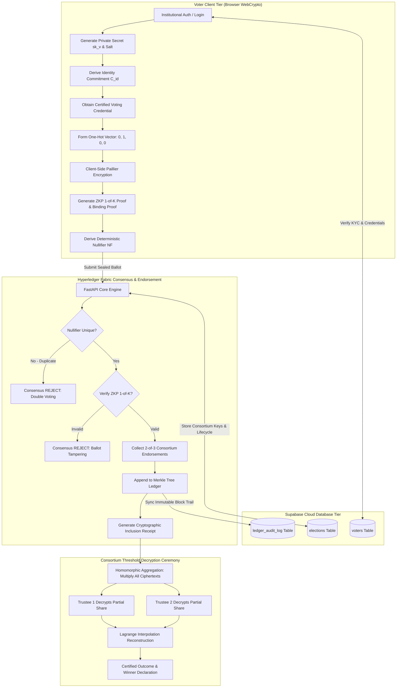

# AegisVote: Enterprise Privacy-Preserving Blockchain E-Voting Infrastructure

> **Institutional-Grade, Zero-Knowledge, Homomorphic E-Voting Architecture on Hyperledger Fabric with Supabase Cloud Ledger Persistence.**  
> Built for the Final Year Engineering Project (2026–27) | Department of Information Science & Engineering, PESCE Mandya.

---

## 👥 Academic & Engineering Credits

- **Institution**: P.E.S. College of Engineering (PESCE), Mandya – 571401  
- **Department**: Department of Information Science & Engineering  
- **Faculty Project Guide**: **Dr. Rakshith N**, Associate Professor, Dept. of IS&E, PESCE Mandya  
- **Student Development Team**:
  1. **Poorna Chandra DH** (USN: `4PS23IS039`) — *Lead Cryptographic Architect & Core Backend*
  2. **Vikas B** (USN: `4PS23IS064`) — *Smart Contracts & Hyperledger Consensus Lead*
  3. **Darshan C** (USN: `4PS23IS007`) — *Cloud Infrastructure & Supabase Persistence*
  4. **Karthik S** (USN: `4PS23IS027`) — *Enterprise Frontend & UI/UX Systems*

---

## 🏛️ Executive Summary & The E-Voting Trilemma

Remote electronic voting has historically suffered from the **E-Voting Trilemma**:
1. **Unconditional Ballot Secrecy**: No party (not even the election commission, government, or database administrator) can tie a cast ballot to a voter's real-world identity.
2. **Individual Verifiability**: A voter can mathematically prove their ballot was cast as intended and recorded on the ledger (*"Cast as intended, recorded as cast"*).
3. **Universal Verifiability**: Any third-party auditor, journalist, or public observer can verify that the final tally equals the exact sum of all valid ballots without decrypting any individual ballot (*"Tallied as recorded"*).

### How AegisVote Solves the Trilemma:
- **Zero Exposure via Paillier Homomorphism**: Ballots are encrypted client-side using Paillier additive homomorphic encryption. The tally is computed homomorphically by multiplying ciphertexts together—individual votes are **never decrypted**.
- **No Single Point of Failure (SPoF)**: Employs a **2-of-3 Threshold Decryption Ceremony** split across 3 sovereign consortium trustees:
  - **Trustee 1**: PESCE Election Commission (`Org1MSP`)
  - **Trustee 2**: Independent Electoral Oversight / Cyber Cell (`Org2MSP`)
  - **Trustee 3**: Public Civil Watchdog NGO (`Org3MSP`)
- **Sybil & Double-Voting Immunity**: Enforces **Credential-Bound Deterministic Nullifiers** ($NF = \text{SHA256}(\text{Domain} \mathbin{\Vert} \text{election\_id} \mathbin{\Vert} sk_v)$) with zero-knowledge binding proofs.
- **Client-Side Proofs**: Uses non-interactive zero-knowledge proofs (NIZK) proving ballots satisfy 1-of-K selection constraints without revealing the chosen candidate.
- **Enterprise UI**: Built with a clean, minimalist, high-contrast dark theme (Linear/Stripe aesthetic) backed by **Supabase Cloud Postgres**.

---

## 🏗️ System Architecture & Workflow



---

## 🔬 Mathematical & Algorithmic Specifications

### 1. Paillier Additive Homomorphic Encryption (Why Not ElGamal?)
Let $n = p \cdot q$ be the RSA modulus, $\lambda = \text{lcm}(p-1, q-1)$, and $g = n + 1$.
- **Encryption**: For message $m \in \{0, 1\}$ and blinding factor $r \in \mathbb{Z}_n^*$:
  $$c = \mathcal{E}(m) = g^m \cdot r^n \pmod{n^2}$$
- **Homomorphic Property**:
  $$\mathcal{E}(m_1) \cdot \mathcal{E}(m_2) = (g^{m_1} r_1^n)(g^{m_2} r_2^n) = g^{m_1 + m_2} (r_1 r_2)^n \equiv \mathcal{E}(m_1 + m_2) \pmod{n^2}$$
- **Aggregate Vector Tally**: For $N$ accepted ballots across $K$ candidates:
  $$C_{\text{aggregate}}[k] = \prod_{i=1}^N c_{i, k} \pmod{n^2} = \mathcal{E}\left(\sum_{i=1}^N v_{i, k}\right)$$
  *Decrypting $C_{\text{aggregate}}$ directly yields the final tally without ever exposing single votes!*

> **Paillier vs. ElGamal Cryptographic Justification**:  
> While standard ElGamal is *multiplicatively homomorphic* ($E(m_1) \cdot E(m_2) = E(m_1 \cdot m_2)$) and useless for tallying votes, *Exponential ElGamal* can add exponents ($g^{m_1} \cdot g^{m_2} = g^{m_1+m_2}$). However, decrypting Exponential ElGamal yields $g^M$, which requires solving a computationally heavy **Discrete Logarithm Problem** ($\mathcal{O}(\sqrt{M})$ using Baby-Step Giant-Step). In contrast, **Paillier is natively additively homomorphic** and decrypts directly to the integer vote tally in **$\mathcal{O}(1)$ constant time** using linear division $L(u) = \frac{u-1}{n}$, scaling seamlessly to millions of voters.

### 2. Hyperledger Fabric Dual-Store Ledger Architecture
Hyperledger Fabric executes a deterministic **Execute-Order-Validate** lifecycle across private consortium channels:
- **Phase 1: Simulation & Endorsement (Execute)**: Client submits proposal to 3 sovereign peers (`Org1MSP`, `Org2MSP`, `Org3MSP`). Peers execute Go chaincode (`voting_contract.go`), simulate against CouchDB, verify ZKP 1-of-K selection proofs, and sign the Read-Write Set.
- **Phase 2: Ordering (Consensus)**: Raft ordering node (`orderer.aegis.election:7050`) sequences endorsed transactions chronologically into immutable blocks with Crash Fault Tolerant (CFT) finality.
- **Phase 3: Validation & Commit**: Peers verify the `2-of-3` signature threshold policy, check for read-write concurrency conflicts (MVCC), append the block to the filesystem blockchain ledger, and atomically update the CouchDB World State (`NULLIFIER_<id> = SPENT`).
- **Ledger Dual-Store**:
  - **World State (CouchDB)**: High-speed $O(1)$ key-value snapshot for checking spent nullifiers and current ballot counts.
  - **Blockchain Block Log (Merkle DAG)**: Cryptographically linked append-only blocks where every ballot transaction forms a leaf in the election Merkle Tree, guaranteeing tamper evidence.

### 3. Shamir's $(t, n)$ Threshold Decryption
The private decryption exponent $S$ is distributed among $n=3$ independent authorities using polynomial $f(x) = S + a_1 x \pmod{\lambda}$:
- Share 1: $s_1 = f(1)$
- Share 2: $s_2 = f(2)$
- Share 3: $s_3 = f(3)$

When voting closes, any $t = 2$ trustees provide partial decryptions. The master plaintext is reconstructed via **Lagrange Interpolation**:
$$S = \sum_{j \in \{1, 2\}} s_j \cdot \ell_j(0) \pmod{\lambda}, \quad \text{where } \ell_j(0) = \prod_{m \ne j} \frac{0 - m}{j - m}$$

### 3. Credential-Bound Nullifier
- **Identity Commitment**:
  $$\mathcal{C}_{\text{id}} = \text{SHA256}(\text{"AEGIS-ID:"} \mathbin{\Vert} sk_v \mathbin{\Vert} \text{salt})$$
- **Deterministic Nullifier**:
  $$\mathcal{NF} = \text{SHA256}(\text{"AEGIS-NULLIFIER:"} \mathbin{\Vert} \text{election\_id} \mathbin{\Vert} sk_v)$$
- Guarantees strict one-voter-one-vote while remaining completely decoupled from real-world student identities.

### 4. Merkle Tree Inclusion ($O(\log N)$ Receipt Verification)
Each ballot transaction forms a leaf hash:
$$\text{Leaf}_i = \text{SHA256}(\text{tx\_id} \mathbin{\Vert} \mathcal{NF}_i \mathbin{\Vert} \text{ciphertext\_summary} \mathbin{\Vert} \text{timestamp})$$
Voters verify ballot inclusion against the public Merkle root with a logarithmic number of sibling hashes.

---

## 🗄️ Supabase Cloud Database Schema

The system uses Supabase (PostgreSQL) hosted in the **South Asia (Mumbai)** region:

### 1. `voters` Table (Identity & Authentication)
```sql
CREATE TABLE IF NOT EXISTS voters (
    voter_id VARCHAR(64) PRIMARY KEY,
    usn VARCHAR(32) UNIQUE NOT NULL,
    full_name VARCHAR(255) NOT NULL,
    department VARCHAR(255) NOT NULL,
    password_hash VARCHAR(255) NOT NULL,
    has_voted BOOLEAN DEFAULT FALSE,
    created_at TIMESTAMP WITH TIME ZONE DEFAULT NOW()
);
```

### 2. `elections` Table (Consortium Registry & Master Keys)
```sql
CREATE TABLE IF NOT EXISTS elections (
    id VARCHAR(64) PRIMARY KEY,
    title VARCHAR(255) NOT NULL,
    description TEXT,
    status VARCHAR(32) DEFAULT 'VOTING',
    public_key_n TEXT NOT NULL,
    public_key_g TEXT NOT NULL,
    merkle_root VARCHAR(64) NOT NULL,
    accepted_ballots_count INT DEFAULT 0,
    created_at TIMESTAMP WITH TIME ZONE DEFAULT NOW()
);
```

### 3. `ledger_audit_log` Table (Immutable Block Trail)
```sql
CREATE TABLE IF NOT EXISTS ledger_audit_log (
    id BIGSERIAL PRIMARY KEY,
    election_id VARCHAR(64) NOT NULL,
    block_number INT NOT NULL,
    tx_id VARCHAR(64) NOT NULL UNIQUE,
    nullifier_hash VARCHAR(64) NOT NULL,
    ciphertext TEXT NOT NULL,
    merkle_leaf VARCHAR(64) NOT NULL,
    created_at TIMESTAMP WITH TIME ZONE DEFAULT NOW()
);
```

---

## 🖥️ User Experience & Web Portals

| Page | URL Path | Description |
| :--- | :--- | :--- |
| **Enterprise Landing** | `/` | System overview, live cryptographic health indicators, and trust metrics. |
| **Identity Gateway** | `/login` | USN authentication against Supabase KYC records with simulated FIDO2 biometrics. |
| **Voting Portal** | `/voting` | Private, client-side encrypted ballot casting with instant cryptographic receipts. |
| **3-Org Consortium** | `/consortium` | Multi-trustee threshold decryption ceremony with live endorsement monitoring. |
| **Certified Results** | `/results` | Official outcome dashboard with homomorphic discrete-log verification proofs. |
| **Universal Verifier** | `/verifier` | Public bulletin board and individual nullifier Merkle inclusion lookup. |

---

## 🍎 macOS Setup Guide (MacBook Air / Pro — Apple Silicon M1/M2/M3/M4/M5)

Running AegisVote on Apple Silicon (ARM64) is fully supported and optimized natively with zero emulator overhead.

### Step 1: Install System Prerequisites
Open your Terminal (`Cmd + Space` -> type `Terminal`) and ensure you have **Homebrew**, **Python**, and **Node.js**:

```bash
# 1. Install Xcode Command Line Tools (required for C cryptographic extensions)
xcode-select --install

# 2. Install Homebrew (if not already installed)
/bin/bash -c "$(curl -fsSL https://raw.githubusercontent.com/Homebrew/install/HEAD/install.sh)"

# 3. Install Python 3.10+ and Node.js LTS
brew install python node
```

### Step 2: Clone the Repository
```bash
git clone https://github.com/Poornachandra-dh/Blockchain-voting-.git
cd Blockchain-voting-
```

### Step 3: Run the One-Click macOS Launcher
We provide an automated launcher for macOS:
```bash
chmod +x start_mac.sh
./start_mac.sh
```
*This automatically creates the Python virtual environment, installs dependencies, boots the FastAPI cryptographic backend, launches the React interface, and opens `http://localhost:3000` in Safari/Chrome!*

---

### Manual Step-by-Step Setup on macOS (Terminal Tabs):

#### Tab 1: FastAPI Backend
```bash
cd backend
python3 -m venv .venv
source .venv/bin/activate

pip install --upgrade pip
pip install -r requirements.txt
python3 start_server.py
```
> **Backend URL**: `http://127.0.0.1:8000`  
> **Swagger API Docs**: `http://127.0.0.1:8000/docs`

#### Tab 2: React Vite Frontend
Open a new Terminal tab (`Cmd + T`):
```bash
cd frontend
npm install
npm run dev
```
> **Frontend URL**: `http://localhost:3000`

---

## ⚡ Quick Start & Local Execution (Windows / Linux)

### Prerequisites
- **Python 3.10+**
- **Node.js v18+**

### 1. Clone the Repository
```bash
git clone https://github.com/Poornachandra-dh/Blockchain-voting-.git
cd Blockchain-voting-
```

### 2. Backend Setup
```bash
cd backend
python -m venv .venv
.\.venv\Scripts\activate      # Windows
source .venv/bin/activate    # Linux / macOS

pip install -r requirements.txt
python start_server.py
```
*Backend runs on `http://127.0.0.1:8000` (API Docs: `http://127.0.0.1:8000/docs`).*

### 3. Frontend Setup
```bash
cd frontend
npm install
npm run dev
```
*Frontend runs on `http://localhost:3000`.*

### 4. Running the Cryptographic Verification Suite
```bash
cd backend
pytest tests/test_crypto_and_pipeline.py -v
```

---

## 🛡️ Security & Threat Resistance Matrix

| Threat Vector | Attack Scenario | AegisVote Mitigation Mechanism |
| :--- | :--- | :--- |
| **Double Voting** | Voter attempts to submit multiple ballots. | The deterministic nullifier $\mathcal{NF}$ is identical. Chaincode consensus rejects the transaction. |
| **Ballot Stuffing** | Attacker injects arbitrary counts like $[100, 0, 0, 0]$. | Non-Interactive Zero-Knowledge (NIZK) 1-of-K selection proof verification fails on all peers. |
| **Rogue Administrator** | Server admin inspects database rows to read votes. | All ballots in database and blockchain are Paillier ciphertexts. Reading votes is mathematically impossible without 2-of-3 threshold keys. |
| **Trustee Collusion** | A corrupt authority attempts unilateral decryption. | 2-of-3 threshold requires at least two sovereign organizations to compute Lagrange shares. |
| **Coercion / Vote Buying** | Coercer demands proof of how voter voted. | Receipt only contains $\mathcal{NF}$ and Merkle leaf hash. Zero candidate data is disclosed. |

---

## 📜 License & Compliance

Distributed under the **MIT License**. Compliant with **NIST SP 800-63-3** (Digital Identity Guidelines) and **Voluntary Voting System Guidelines (VVSG 2.0)** for end-to-end verifiability (E2E-V).
