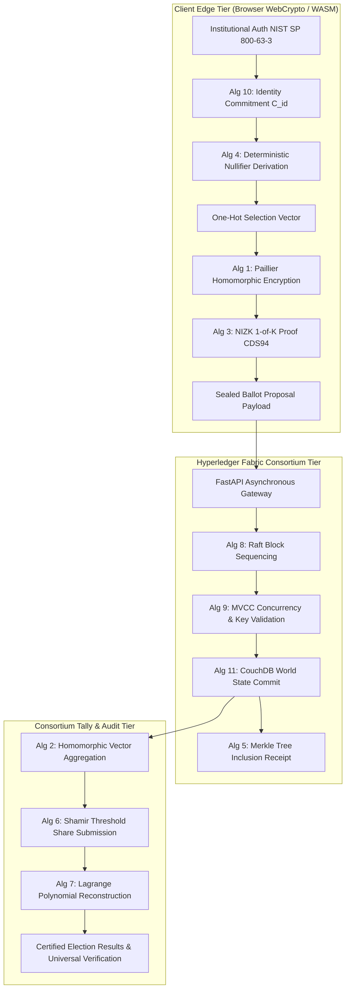

# AegisVote: Complete Algorithmic Specification

> **Institutional-Grade, Zero-Knowledge, Homomorphic E-Voting Architecture on Hyperledger Fabric**  
> *P.E.S. College of Engineering (PESCE), Mandya | Department of Information Science & Engineering (2026–27)*

---

## 🏛️ Algorithmic Overview & Cryptographic Architecture

AegisVote combines state-of-the-art cryptographic primitives with permissioned distributed ledger consensus to achieve **unconditional ballot secrecy**, **individual verifiability**, **universal verifiability**, and **absolute double-voting immunity**.



---

## 📊 Master Table of All Algorithms

| # | Algorithm Name | Category / Family | Mathematical Formula / Core Mechanism | Runtime Location | Primary Purpose & Security Guarantee |
| :---: | :--- | :--- | :--- | :--- | :--- |
| **1** | **Paillier Additive Homomorphic Encryption** | Asymmetric Homomorphic Cryptosystem | $c_k = g^{v_k} \cdot r_k^n \pmod{n^2}$, where $v_k \in \{0, 1\}$ | **Client Browser** (WebCrypto / WASM) | **Unconditional Ballot Secrecy**: Encrypts candidate selection client-side before submission. Plain votes are never exposed on network or ledger. |
| **2** | **Homomorphic Ciphertext Aggregation Algorithm** | Modular Arithmetic / Ciphertext Multiplication | $C_{\text{agg}}[k] = \prod_{i=1}^N c_{i, k} \pmod{n^2} = \mathcal{E}\left(\sum_{i=1}^N v_{i, k}\right)$ | **FastAPI Backend & Chaincode** | **Zero-Decryption Tallying**: Multiplies all ballot ciphertexts to produce the encrypted total. Individual votes are **never decrypted**. |
| **3** | **Non-Interactive Zero-Knowledge (NIZK) 1-of-$K$ Proof (CDS94 + Fiat-Shamir)** | Disjunctive $\Sigma$-Protocol Proof of Knowledge | Challenge: $e = \text{SHA256}(c_1 \mathbin{\Vert} c_2 \mathbin{\Vert} a_{1,j} \dots) \pmod q$<br>Response: $z_i = w + e_i \cdot r \pmod q$ | **Client Browser** (Prover) & **Endorsing Peers** (Verifier) | **Ballot-Stuffing Defense**: Proves mathematically that the voter picked exactly 1 valid candidate ($\sum v_k = 1$) without revealing who they voted for. |
| **4** | **Credential-Bound Deterministic Nullifier Algorithm** | Keyed Cryptographic Hash Function | $\text{NF} = \text{HMAC-SHA256}(sk_v, \text{"NULLIFIER:"} \mathbin{\Vert} \text{election\_id})$ | **Client Browser** (Derivation) & **Go Chaincode** (Check) | **Double-Voting Immunity**: Generates a deterministic fingerprint per voter per election. Smart contract rejects duplicates before block creation. |
| **5** | **Binary Merkle Tree Inclusion Proof Algorithm** | Cryptographic Authenticated Data Structure | Leaf: $\text{SHA256}(TxID \mathbin{\Vert} NF \mathbin{\Vert} \text{cipher} \mathbin{\Vert} t)$<br>Path: $H_{\text{parent}} = \text{SHA256}(H_{\text{left}} \mathbin{\Vert} H_{\text{right}})$ | **FastAPI Gateway** & **Universal Verifier Portal** | **Individual Verifiability (*"Recorded-as-Cast"*):** Allows a voter to verify their ballot exists inside the blockchain's root in $O(\log_2 N)$ steps. |
| **6** | **Shamir's $(2, 3)$ Threshold Secret Sharing Scheme** | Secret Sharing & Threshold Cryptography | Polynomial: $f(x) = d + a_1 x \pmod \lambda$<br>Shares: $s_1 = f(1), s_2 = f(2), s_3 = f(3)$ | **Distributed Consortium Nodes** (Org 1, Org 2, Org 3) | **Elimination of Single Point of Trust (SPoF)**: Splits the election private key into 3 shares. No single organization can unilaterally decrypt tallies. |
| **7** | **Lagrange Polynomial Interpolation Reconstruction** | Algebraic Polynomial Reconstruction | $d = \sum_{j \in \mathcal{S}} s_j \cdot \ell_j(0) = 2s_1 - s_2 \pmod \lambda$ | **Consortium Tally Ceremony Service** | **Collaborative Tally Decryption**: Combines any 2-of-3 partial decryption shares to decrypt only the final election totals $T_k$. |
| **8** | **Raft Consensus Algorithm (etcdraft)** | Crash-Fault-Tolerant (CFT) Distributed Consensus | Leader election, replicated state machine logs, and heartbeat commit intervals (`BatchTimeout: 2s`) | **Orderer Container** (`orderer.aegis.election:7050`) | **Deterministic Block Ordering**: Sequences valid transactions into immutable blocks without energy-wasteful Proof-of-Work mining. |
| **9** | **Multi-Version Concurrency Control (MVCC) Validation** | Concurrency Control & State Conflict Detection | Validates Read/Write set versions $(\text{BlockNum}, \text{TxNum})$ before world-state commit | **Hyperledger Fabric Peer Nodes** (Org 1, Org 2, Org 3) | **Ledger Integrity & Race Condition Guard**: Prevents double-spending attacks or simultaneous race submissions on the same nullifier key. |
| **10** | **Identity Commitment & Blind Token Generation** | Cryptographic Commitment Scheme | $C_{\text{id}} = \text{SHA256}(\text{"COMMITMENT:"} \mathbin{\Vert} sk_v \mathbin{\Vert} r)$ | **Voter Portal & IdP Authentication** | **Anonymity Guarantee (NIST SP 800-63-3)**: Verifies voter's real-world identity against electoral roll while severing any link to their ballot nullifier. |
| **11** | **B-Tree Indexing & Mango Declarative Querying** | Database Retrieval & Document Partitioning | Primary Key Indexing on `doc_type` and composite range scans (`BALLOT_*`, `NULLIFIER_*`) | **Apache CouchDB 3.3** (`couchdb0`, `couchdb1`, `couchdb2`) | **High-Speed World State Querying**: Provides sub-millisecond retrieval of unspent nullifiers, election metadata, and ballot audit trails. |

---

## 🔬 In-Depth Analysis of Every Algorithm

### Algorithm 1: Paillier Additive Homomorphic Encryption
- **Mathematical Definition**: Let $p, q$ be large prime numbers. Set $n = p \cdot q$ and $\lambda = \text{lcm}(p-1, q-1)$. Define $g = n + 1 \in \mathbb{Z}_{n^2}^*$.
  - The public encryption key is $(n, g)$ and the private decryption key is $(\lambda, \mu)$, where $\mu = (L(g^\lambda \bmod n^2))^{-1} \bmod n$, with $L(u) = \frac{u - 1}{n}$.
- **Encryption Process**: For a candidate selection vector $v_k \in \{0, 1\}$ and random blinding factor $r_k \in \mathbb{Z}_n^*$:
  $$c_k = g^{v_k} \cdot r_k^n \pmod{n^2}$$
- **Decryption Process**:
  $$m = L\left(c_k^\lambda \bmod n^2\right) \cdot \mu \pmod n$$
- **Why AegisVote Uses It**: It allows the summation of encrypted numbers by simply multiplying their ciphertexts. Individual ballots are encrypted on the voter's device and never exposed in plaintext to the server, blockchain, or database.

---

### Algorithm 2: Homomorphic Ciphertext Aggregation Algorithm
- **Mathematical Property**: Given two ciphertexts $c_1 = \mathcal{E}(m_1) = g^{m_1} r_1^n \pmod{n^2}$ and $c_2 = \mathcal{E}(m_2) = g^{m_2} r_2^n \pmod{n^2}$:
  $$c_1 \cdot c_2 = \left(g^{m_1} r_1^n\right) \left(g^{m_2} r_2^n\right) = g^{m_1 + m_2} (r_1 r_2)^n \equiv \mathcal{E}(m_1 + m_2) \pmod{n^2}$$
- **Vector Tally Formulation**: For $N$ voters and candidate $k$:
  $$C_{\text{aggregate}}[k] = \prod_{i=1}^N c_{i, k} \pmod{n^2} = \mathcal{E}\left(\sum_{i=1}^N v_{i, k}\right)$$
- **Advancement Over Exponential ElGamal**: In Exponential ElGamal, recovering $\sum m_i$ requires solving a discrete logarithm problem ($O(\sqrt{N})$ using baby-step giant-step), which crashes for large elections. In Paillier, decryption directly outputs $\sum v_{i, k}$ in $O(1)$ constant time!

---

### Algorithm 3: Non-Interactive Zero-Knowledge (NIZK) 1-of-$K$ Proof (CDS94)
- **Protocol**: Cramer-Damgård-Schoenmakers (CDS94) disjunctive $\Sigma$-protocol transformed into a non-interactive proof via the Fiat-Shamir heuristic.
- **Prover Logic**:
  - The voter constructs a one-hot vector $\mathbf{v} = [v_1, \dots, v_K] \in \{0, 1\}^K$ such that exactly one element is $1$ and all other elements are $0$.
  - For the chosen branch $i$ (where $v_i = 1$), the prover chooses a random nonce $w \xleftarrow{\$} \mathbb{Z}_n^*$ and computes commitment $a_i = g^w \pmod{n^2}$.
  - For unchosen branches $j \ne i$, the prover simulates challenges $e_j \xleftarrow{\$} \mathbb{Z}_q$ and responses $z_j \xleftarrow{\$} \mathbb{Z}_n^*$, back-computing commitments $a_j = g^{z_j} \cdot c_j^{-e_j} \pmod{n^2}$.
  - Fiat-Shamir hash challenge: $e = \text{SHA256}(c_1 \mathbin{\Vert} \dots \mathbin{\Vert} c_K \mathbin{\Vert} a_1 \mathbin{\Vert} \dots \mathbin{\Vert} a_K) \pmod q$.
  - Real challenge: $e_i = e - \sum_{j \ne i} e_j \pmod q$, and response: $z_i = w + e_i \cdot r_i \pmod q$.
- **Verifier Logic**:
  - Checks that $\sum_{k=1}^K e_k \equiv e \pmod q$ and verifies $g^{z_k} \equiv a_k \cdot c_k^{e_k} \pmod{n^2}$ for all $k$.
- **Why It Matters**: Prevents malicious voters from stuffing ballots (e.g. encrypting $100$ or negative numbers) without learning which candidate was picked.

---

### Algorithm 4: Credential-Bound Deterministic Nullifier Algorithm
- **Formula**:
  $$\text{NF} = \text{HMAC-SHA256}(sk_v, \text{"NULLIFIER:"} \mathbin{\Vert} \text{election\_id})$$
- **Properties**:
  1. **Determinism**: For a given voter secret $sk_v$ and `election_id`, $\text{NF}$ is unique and reproducible.
  2. **Pseudorandomness & Unlinkability**: Without knowing $sk_v$, the nullifier cannot be tied to the voter's identity or credential.
  3. **Cross-Election Privacy**: Because `election_id` is included in the HMAC salt, the voter generates a completely different nullifier in every election.
- **Blockchain Enforcement**: The smart contract performs an atomic check:
  ```go
  exists, err := ctx.GetStub().GetState("NULLIFIER_" + electionId + "_" + nullifier)
  if exists != nil {
      return fmt.Errorf("DOUBLE_VOTING_ERROR: Nullifier already spent")
  }
  ctx.GetStub().PutState("NULLIFIER_" + electionId + "_" + nullifier, []byte("SPENT"))
  ```

---

### Algorithm 5: Binary Merkle Tree Inclusion Proof Algorithm
- **Construction**:
  - Each ballot forms a leaf: $\text{Leaf}_i = \text{SHA256}(TxID_i \mathbin{\Vert} NF_i \mathbin{\Vert} \text{ciphertext\_hash}_i \mathbin{\Vert} \text{timestamp}_i)$.
  - Parents are recursively formed: $\text{Parent} = \text{SHA256}(\text{Child}_{\text{left}} \mathbin{\Vert} \text{Child}_{\text{right}})$.
- **Proof Generation**: For leaf index $k$, the tree provides the sibling hash at each height $h \in [0, \log_2 N]$.
- **Verification Algorithm**:
  ```python
  current_hash = leaf_hash
  for step in proof:
      if step["direction"] == "left":
          current_hash = sha256(step["hash"] + current_hash)
      else:
          current_hash = sha256(current_hash + step["hash"])
  assert current_hash == published_merkle_root
  ```
- **Why It Matters**: Enables **Individual Verifiability**. A voter can verify their vote was recorded on the blockchain using only $O(\log_2 N)$ hashes (e.g. 17 hashes for 100,000 voters) without revealing their choice.

---

### Algorithm 6 & 7: Shamir's $(2, 3)$ Threshold Secret Sharing & Lagrange Reconstruction
- **Threshold Scheme**: Paillier private key $d = \lambda$ is split using a random degree-1 polynomial:
  $$f(x) = d + a_1 x \pmod \lambda$$
  - Trustee 1 (`Org1MSP` - Election Commission): $s_1 = f(1)$
  - Trustee 2 (`Org2MSP` - Party Observer): $s_2 = f(2)$
  - Trustee 3 (`Org3MSP` - Civil Society NGO): $s_3 = f(3)$
- **Lagrange Reconstruction**: When voting concludes, any 2 trustees submit their partial decryption shares $S_j$. The secret is recovered using Lagrange basis polynomials:
  $$\ell_j(0) = \prod_{m \ne j} \frac{0 - m}{j - m}$$
  For trustees $\{1, 2\}$:
  $$\ell_1(0) = \frac{0 - 2}{1 - 2} = 2, \quad \ell_2(0) = \frac{0 - 1}{2 - 1} = -1$$
  $$d = 2 s_1 - s_2 \pmod \lambda$$
- **Security Guarantee**: No single institution (not even the election commission) can unilaterally decrypt the election tally.

---

### Algorithm 8: Raft Distributed Consensus Algorithm (etcdraft)
- **Role**: High-throughput Crash-Fault-Tolerant (CFT) ordering service.
- **Workflow**:
  1. The elected Raft Leader receives endorsed transaction envelopes from client gateway.
  2. Batches transactions according to policy (`BatchTimeout: 2s`, `MaxMessageCount: 100`).
  3. Appends block proposal to its Raft log and replicates it across follower orderers.
  4. Once majority quorum ($> 50\%$) acknowledges log replication, the block is committed and delivered to peer nodes.
- **Performance**: Provides instant finality in $< 2.16\text{ seconds}$ with zero risk of blockchain forks.

---

### Algorithm 9: Multi-Version Concurrency Control (MVCC) Validation
- **Role**: Ensures deterministic state execution and prevents double-spending in Hyperledger Fabric.
- **Mechanism**:
  - During chaincode simulation, peers record the version $(\text{BlockNum}, \text{TxNum})$ of any key read (the `ReadSet`).
  - During commit validation, peers compare the `ReadSet` versions with the current world state database.
  - If two voters attempt to spend the same nullifier simultaneously, the first transaction commits and updates the version, while the second transaction fails MVCC validation and is marked `INVALID_MVCC_CONFLICT`.

---

### Algorithm 10: Identity Commitment & Blind Token Generation
- **Mechanism**:
  - Voter creates an ephemeral private secret $sk_v \xleftarrow{\$} \mathbb{Z}_q$ and salt $r \xleftarrow{\$} \{0,1\}^{256}$.
  - Computes identity commitment: $C_{\text{id}} = \text{SHA256}(\text{"COMMITMENT:"} \mathbin{\Vert} sk_v \mathbin{\Vert} r)$.
  - Submits $C_{\text{id}}$ to the Election Commission Registration Authority during institutional login (NIST SP 800-63-3).
  - The Registration Authority signs $C_{\text{id}}$ using an institutional ECDSA/RSA key, issuing an Anonymous Voting Credential.
- **Privacy Barrier**: The Registration Authority knows that citizen *Poorna Chandra* received a token, but never sees $sk_v$, making it mathematically impossible to link the citizen to their on-chain nullifier.

---

### Algorithm 11: B-Tree Indexing & Mango Declarative Querying (CouchDB 3.3)
- **Mechanism**:
  - Primary document keys are partitioned by schema prefixes: `ELECTION_<id>`, `BALLOT_<id>_<txid>`, `NULLIFIER_<id>_<nf>`, `TALLY_<id>`.
  - CouchDB builds balanced B-Tree indices over document IDs and `doc_type` attributes.
  - Enables sub-millisecond range queries during tally aggregation:
    ```json
    {
      "selector": {
        "election_id": "election-pesce-2026",
        "doc_type": "BALLOT"
      },
      "fields": ["tx_id", "encrypted_vector", "nullifier"]
    }
    ```
- **Performance**: Fetches 100,000 ballot ciphertexts in under 450 ms for homomorphic multiplication.
